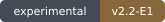

<h1 align="center">The Minish Cap 3DS</h1>

<p align="center">
  <strong>A small hero. A two-screen adventure.</strong><br>
  The Minish Cap, adapted for Nintendo 3DS.
</p>

<p align="center">
  <a href="#download-and-installation">Download</a> ·
  <a href="#features">Features</a> ·
  <a href="#documentation">Documentation</a> ·
  <a href="docs/CONTRIBUTING.md">Contribute</a> ·
  <a href="#community-and-bug-reports">Community</a>
</p>

<p align="center">
  <a href="https://github.com/EstebanPdN/zelda-tmc-3ds/releases/tag/v2.1"></a>
  <a href="#download-and-installation"></a>
  <a href="https://github.com/EstebanPdN/zelda-tmc-3ds/releases/tag/v2.2-E1"></a>
  <a href="#updates"></a>
  <a href="THIRD-PARTY-LICENSES.md"></a>
</p>

<p align="center">
  
</p>

<p align="center">
  <a href="https://estebanpdn.github.io/"></a>
  <a href="https://discord.gg/BjbzfRYpV"></a>
</p>

Nintendo 3DS dual-screen port of *The Legend of Zelda: The Minish Cap*, based on the open-source Minish Cap decompilation, Project Picori, and the dual-screen Android port.

Made with the help of Codex.

This project is based on open-source work from:

* [samyost1/tmc-android](https://github.com/samyost1/tmc-android) — dual-screen Android source base
* [Project Picori](https://github.com/999sian/tmc) — native Minish Cap engine and port infrastructure
* [zeldaret/tmc](https://github.com/zeldaret/tmc) — original decompilation

No ROM or extracted Nintendo game assets are distributed with this project. You must provide your own legally obtained compatible Game Boy Advance ROM.

## Features

<table>
  <tr>
    <td width="50%" valign="top"><strong>Explore a smaller world</strong><br>Native Minish Cap gameplay with USA and European ROM support and regional backports.</td>
    <td width="50%" valign="top"><strong>Made for two screens</strong><br>Wide top-screen gameplay with maps, quest status, touch items and settings below.</td>
  </tr>
  <tr>
    <td width="50%" valign="top"><strong>Choose your presentation</strong><br>Wide, Original and Stretch modes; Blur, Bilinear and Pixel Perfect styles.</td>
    <td width="50%" valign="top"><strong>Keep it current</strong><br>Stable / Pre-release updates, persistent settings, native audio and diagnostic checkpoints.</td>
  </tr>
</table>

### Feature details

* Native Nintendo 3DS port with full dual-screen support.
* Supports both USA and European ROMs with automatic region detection.
* Includes native [European gameplay backports](docs/eu-backport.md); no patched ROM is required.
* True widescreen gameplay on the 400x240 top screen, plus Original and Stretch display modes.
* Bottom-screen interface with live map, dungeon information, quest status, touch item controls, and settings.
  The opening Picori legend keeps the bottom screen black; the overworld map
  shows only its stone frame until Link receives it.
* New 3DS enhancements including 804 MHz mode, L2 cache, multi-core rendering, and optional 2x–5x turbo using the C-Stick.
* Three display styles: Blur, Bilinear, and Pixel Perfect.
* On New Nintendo 3DS, the existing Wide + Pixel Perfect combination enables
  experimental Full View: compatible outdoor rooms render at 400x240, while
  supported interiors use a centered 200x120 view scaled exactly 2x.
* In-app updates with Stable and Pre-release channels, top-screen changelogs, and verified CIA/3DSX installation.
* Native stereo audio, persistent settings, reliable save handling, FPS tools, and diagnostic dumps for bug reports.

## Performance

The port automatically selects a performance profile for the detected console.

**New Nintendo 3DS** keeps the full-presentation path with 804 MHz mode, L2 cache, multi-core rendering, and C-Stick turbo.

**Old Nintendo 3DS** uses an optimized renderer, lower-overhead audio path, and adaptive presentation-skip profile. When rendering cannot sustain 60 visual FPS, the engine can continue advancing near its 60 Hz target instead of slowing the entire game down. Input, touch, audio, and lifecycle handling continue to run on skipped presentation ticks.

The bottom-screen worker avoids redundant static redraws while keeping touch input sampled on every engine tick.

<a id="installation"></a>

## Download and installation

<p>
  <a href="https://github.com/EstebanPdN/zelda-tmc-3ds/releases/download/v2.1/tmc-3ds-v2.1.cia"></a>
  <a href="https://github.com/EstebanPdN/zelda-tmc-3ds/releases/download/v2.1/tmc-3ds-v2.1.3dsx"></a>
</p>

**Stable: [v2.1](https://github.com/EstebanPdN/zelda-tmc-3ds/releases/tag/v2.1).** Experimental: [v2.2-E1](https://github.com/EstebanPdN/zelda-tmc-3ds/releases/tag/v2.2-E1).

**Experimental v2.2-E1** fixes normal saves being rejected when previous
versions left empty legacy metadata beside them. Install it over the existing
application; keep your `.sav` and companion files. The fix recognizes that
inactive metadata without deleting it. Active or unrecognized legacy profiles
remain protected. Download the experimental CIA or 3DSX from
[v2.2-E1](https://github.com/EstebanPdN/zelda-tmc-3ds/releases/tag/v2.2-E1).
The stable release remains v2.1.

1. Install the CIA with FBI, or use the 3DSX build with the Homebrew Launcher.

```text
tmc-3ds-v2.1.cia
```

2. Create this folder on your SD card:

```text
sdmc:/3ds/The Minish Cap 3DS/
```

3. Place your legally obtained USA or European `.gba` ROM inside that folder.

The ROM can have **any filename** as long as it uses the `.gba` extension.

### Recommended ROM

Both the **USA** and **European** versions are supported, but I **highly recommend using the European ROM**.

The European version is the ROM I used throughout the development and testing of this port, so it has received by far the most testing.

The USA version should be compatible, but it behaves slightly differently in some parts of the game, so you may encounter bugs that are not present when using the European version.

The European ROM also includes multiple languages, **including English**, so there is generally no disadvantage to using it.

Expected clean ROM SHA-1 values:

```text
USA:    b4bd50e4131b027c334547b4524e2dbbd4227130
Europe: cff199b36ff173fb6faf152653d1bccf87c26fb7
```

The ROM stays on your SD card and is never included in the CIA.

### Audio

Audio requires a working Nintendo 3DS DSP firmware setup.

If homebrew audio is not working, open the Luma3DS Rosalina Menu and use:

```text
Miscellaneous options > Dump DSP firmware
```

## Diagnostics

If you encounter a crash, graphical bug, performance problem, or anything unusual, press:

```text
L + R + A
```

The port will pause and create a diagnostic dump containing screenshots, memory information, runtime state, performance data, and other information that can help identify the problem.

Dumps are saved under:

```text
sdmc:/3ds/The Minish Cap 3DS/dumps/
```

Gameplay dumps also include a validated `load-state.bin` checkpoint. To reproduce the most recent dump, open:

```text
Settings > Developer > Load State
```

New sessions use `000-dump-YYYYMMDD-HHMMSS`, `001-dump-YYYYMMDD-HHMMSS`, and so on.
The sequence survives restarts and clock changes; an emptied dumps folder starts again at 000.

The loader asks for confirmation, selects the newest numbered folder (or a legacy `dump-*` folder), and rejects corrupted checkpoints or checkpoints
created with a different ROM region. Older dumps that only contain `save-state.bin` remain supported, but they resume
from the saved checkpoint rather than the exact captured position.

Please send the dump when reporting bugs whenever possible.

## Updates

Open **Settings > Update**. Select **Stable** or **Pre-release**, then tap the
release version to read its changelog on the top screen. Use **Prev / Next** to
turn pages. **Download Update** asks for confirmation before downloading and
installing. Save your game first: the application closes after a successful update.

CIA builds overwrite only this application's title after checking its ID and
SHA-256 digest. 3DSX builds replace the launched file with rollback protection.
Wi-Fi is required; connection failures leave the current installation available.

## Releases

Every GitHub release includes:

* Installable CIA
* Homebrew Launcher 3DSX
* FBI QR code
* Source code archive

Latest release:

https://github.com/EstebanPdN/zelda-tmc-3ds/releases/latest

## Documentation

| Guide | Purpose |
| --- | --- |
| [3DS guide](platform/3ds/README.md) | Platform controls, setup and diagnostics. |
| [Documentation index](docs/README.md) | Engine, regional and development documentation. |
| [European gameplay backports](docs/eu-backport.md) | Native regional changes and compatibility. |
| [Contributing](docs/CONTRIBUTING.md) | Development guidance. |
| [Updates](#updates) | Channels, verification and installation recovery. |

## Building

Requirements:

* devkitPro
* devkitARM
* libctru
* Citro2D
* Citro3D
* CMake
* `makerom` and `bannertool` for CIA packaging

Build with:

```sh
chmod +x platform/3ds/build.sh
./platform/3ds/build.sh
```

Builds are generated under:

```text
build-3ds/game/tmc-3ds-v2.2-E1.cia
build-3ds/game/tmc-3ds-v2.2-E1.3dsx
```

The build does not include or embed a ROM.

## Credits

* [samyost1/tmc-android](https://github.com/samyost1/tmc-android) — dual-screen Android source base used for this port
* [Project Picori](https://github.com/999sian/tmc) — native Minish Cap engine and port infrastructure
* [Raekwon1603/tmc-android](https://github.com/Raekwon1603/tmc-android) — Android packaging and platform work behind the dual-screen fork
* [zeldaret/tmc](https://github.com/zeldaret/tmc) — original decompilation
* Esteban PDN — Nintendo 3DS port and release maintenance

## License and Legal Notice

Original port contributions are distributed under **GNU GPL v3.0 or later**.
See [LICENSE](LICENSE) for the full terms and [COPYRIGHT.md](COPYRIGHT.md) for scope and attribution.

Each release's **Source code** download contains the corresponding application
and library sources and build scripts. The 3DS build uses **agbplay** by ipatix
and contributors under **LGPL v3.0**; its [notice](libs/agbplay_core/LICENSE)
and [license text](libs/agbplay_core/COPYING.LESSER) are included. You may modify
that library and rebuild the CIA or 3DSX with the documented build command.

Third-party components retain their respective licenses as listed in [THIRD-PARTY-LICENSES.md](THIRD-PARTY-LICENSES.md).

Nintendo owns *The Legend of Zelda*, *The Minish Cap*, and all associated game content.

This is an unofficial fan-made project and is not affiliated with or endorsed by Nintendo.

No ROM, extracted Nintendo game assets, save data, or firmware is distributed with this project.

## Community and bug reports

[Join the project Discord](https://discord.gg/BjbzfRYpV) for updates, testing,
suggestions and support. Use [GitHub issues](https://github.com/EstebanPdN/zelda-tmc-3ds/issues)
for reproducible reports, including your version, console model and steps to
reproduce the problem. Review diagnostic captures before sharing them.

---

<p align="center">
  <a href="https://estebanpdn.github.io/">Esteban’s Forge</a> ·
  <a href="https://discord.gg/BjbzfRYpV">Discord</a> ·
  <a href="#documentation">Documentation</a> ·
  <a href="THIRD-PARTY-LICENSES.md">License and notices</a><br>
  <sub>An independent fan project. Game names and content belong to their respective owners.</sub>
</p>
