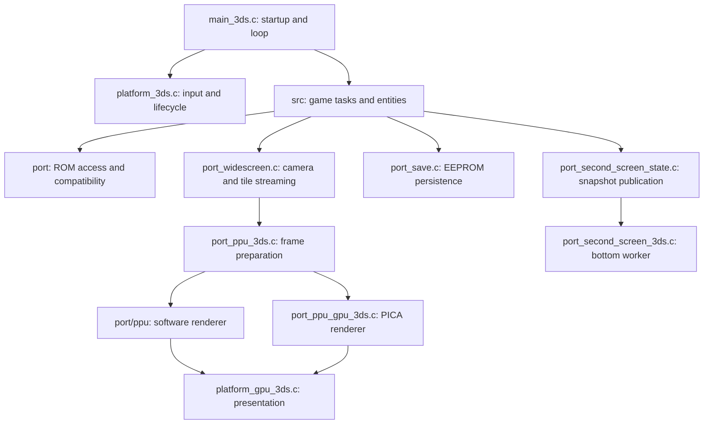

# Architecture and source ownership

This map describes the maintained Nintendo 3DS port. The engine retains its
upstream C layout, region definitions, global state and data ordering. Moving or
renaming those symbols is not part of a presentation or formatting change.

## Repository map

| Location | Responsibility | Change boundary |
| --- | --- | --- |
| `src/`, `include/` | Game tasks, entities, rooms, scripts, saves and public engine declarations | Preserve retail state, region behavior, callback order and layouts. |
| `src/enemy/`, `src/npc/`, `src/object/`, `src/playerItem/`, `src/projectile/`, `src/manager/` | Entity behavior by engine kind | Retain existing names, dispatch tables and allocation contracts. |
| `src/menu/`, `src/subtask/`, `src/worldEvent/`, `src/item/` | Menus, temporary game tasks, scripted world events and item behavior | Preserve restoration of suspended engine state. |
| `src/data/`, `data/`, `constants/`, `asm/` | Upstream declarations, assembly and symbolic data descriptions | Preserve byte order, table order, provenance and regional addresses. |
| `port/` | Shared native adaptations and engine bridges | Platform-independent compatibility and bounded data access. |
| `port/ppu/` | Software PPU, register/memory interfaces and renderer regressions | Preserve palette, blending, window, sprite and HDMA semantics. |
| `platform/3ds/source/` | libctru, Citro2D/3D, input, audio, display, lifecycle and updater adapters | Hardware effects and service ownership stay here. |
| `platform/3ds/tests/` | Host-testable 3DS policies and service mocks | No physical-console claims from mocks. |
| `tests/port/` | Shared engine/port regressions previously mixed into `port/` | Fixtures use temporary working directories. |
| `libs/`, `port/SDL3/` | Imported dependencies | Keep upstream notices, attribution and imported style. |
| `tools/`, `scripts/dev/` | Data producers, development commands and repository checks | Tools are not game-loop code; document their inputs and effects. |
| `platform/3ds/cia/`, `platform/3ds/romfs/`, `platform/3ds/assets/` | Packaging metadata, public certificates and original presentation assets | No ROM, save, extracted game asset or private diagnostic input. |
| `android/`, `mods/`, `translations/` | Inherited platform shell, mod examples and localization sources | Keep inherited consumers and build paths available. |
| `build/USA/assets/`, `build/EU/assets/` | Tracked symbolic offset headers | Generated symbol-to-offset descriptions, not game assets. |
| `docs/` | Current guides, technical references and dated investigation history | Start at the documentation index; historical reports are not current guarantees. |

## Execution and effects

Input sampling, engine updates and presentation are distinct operations. The
Old 3DS frame pacer may omit a presentation while the engine, input and audio
continue. Keep that ordering and the existing bounded work policies intact.
The bottom worker consumes published snapshots; it must not acquire ownership
of mutable engine globals. The bottom-screen development boot console remains
part of startup.

## Shared port responsibilities

| Module family | Owns | Important contract |
| --- | --- | --- |
| `port_rom`, `port_region_data`, `port_gba_mem`, `port_offset_remap` | ROM discovery, native/GBA pointer resolution and regional data provenance | Resolve the owning table and active region before following embedded pointers. |
| `port_linked_stubs`, `port_room_funcs`, `port_script_funcs`, `port_gameplay_stubs` | Native replacements for engine/assembly entry points | Preserve names, calling convention, global layout and state ordering. |
| `port_widescreen` | Room-capped camera geometry, outgoing map retention, reveal shadows, dialogue/banner placement | 3DS normal view is at most 266×160; no filter-dependent camera mode. |
| `port_widescreen_internal.h` | Native rolling-tilemap bridge used by `UpdateScrollVram` | Zero return requests the original fill; buffers are borrowed. |
| `port_save`, `port_bottle_compat`, `port_bomb_compat`, `port_vaati_progress`, `port_cloud_tops_fight` | Persistence and narrowly scoped compatibility recovery | Keep old profiles readable; preserve rejected files and backup-before-repair rules. |
| `port_second_screen_*` | Snapshot, themed composition, world/dungeon maps and quest information | Preserve discovery, map ownership, touch coordinates and paint invalidation. |
| `port_m4a_*`, `libs/agbplay_core` | Engine sound bridge and synthesis | Retain sample routing, scheduling and source-specific compiler flags. |
| `port_hdma`, `port_draw`, `port_filter`, `port_animation` | Native rendering bridges | No SD access or allocations added to per-frame paths. |

## 3DS ownership

- `main_3ds.c` composes startup and the runtime loop; `platform_3ds.c` owns
  device input, timing, lifecycle and diagnostic entry points.
- `port_config_3ds.c` owns persistent settings. Aspect and filter are separate
  selections. Existing INI keys and enum values remain compatible.
- `top_view_3ds.c` is the pure source/destination rectangle and filter policy.
  `platform_gpu_3ds.c` executes the plan through Citro2D/3D.
- `port_ppu_3ds.c` prepares each frame and chooses the existing CPU/GPU paths.
  `port_ppu_gpu_3ds_model.c` builds bounded draw plans; the GPU implementation
  submits those plans. Command-budget failure keeps the same-frame CPU fallback.
- `port_audio_3ds.c`, `ndsp_*_offload.c` and `speaker_eq_3ds.c` own device audio.
- `updater.c` owns download/install effects; `update_manifest.c` parses metadata.
  Preserve channel selection, validation, cancellation and rollback behavior.
- `port_dump_state_3ds.c` owns checkpoints. Physical screenshots come from the
  currently displayed framebuffers, independently of logical render capacity.

## Data and threading constraints

Engine globals and packed layouts are compatibility boundaries, not candidates
for cosmetic object-oriented replacement. Headers own cross-file declarations.
Do not reorder include files automatically: some engine headers depend on
region/build definitions and existing declaration order.

Generated tables (`data_*stubs*`, `stubs_autogen`, `port_rom_tables`,
`flag_remap_generated`, `generated_sounds_embed`) keep their producer's format.
Change their generator when changing the representation. Imported dependencies
keep their upstream formatting and component licenses. Maintained game and port
C/C++ uses the checked repository style; see [development](DEVELOPMENT.md).

## Presentation decision for v2.2

The Wide + Pixel Perfect experimental outdoor 400×240 and interior 200×120
policies have been removed, including their activation gate, room-generation
latch and camera changes. The ordinary Wide camera and all three filters remain.
Pixel Perfect displays the native 240/room-capped-wide ×160 source centered at
1:1. Blur and Bilinear retain the existing physical scaling. The binary retains
its renderer buffer capacity so checkpoint and upload assumptions are not
silently changed as part of this removal.
